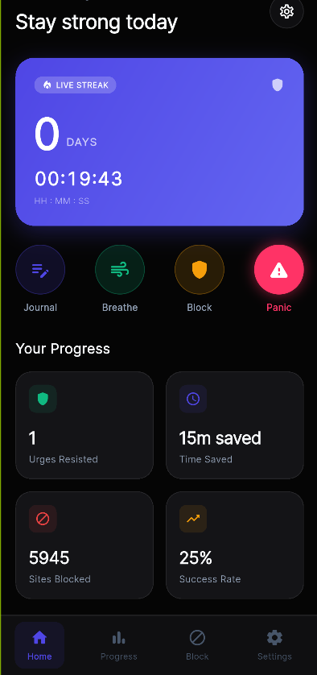
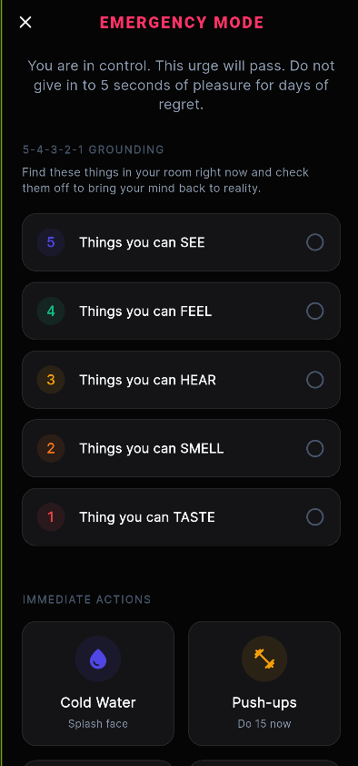
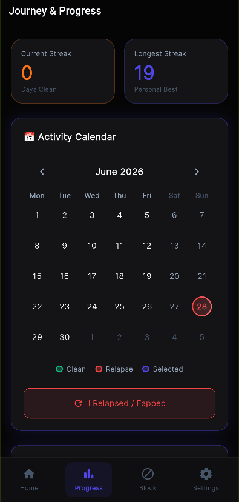
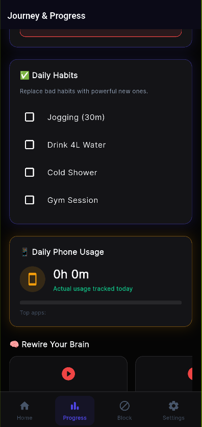
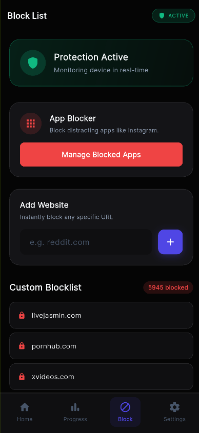
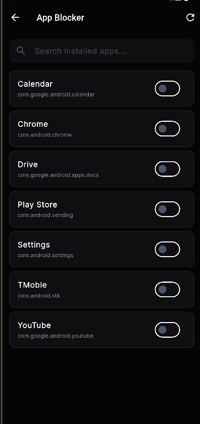
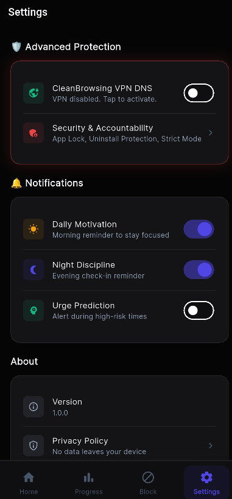
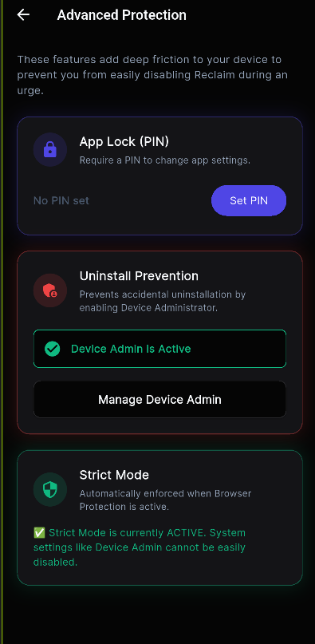
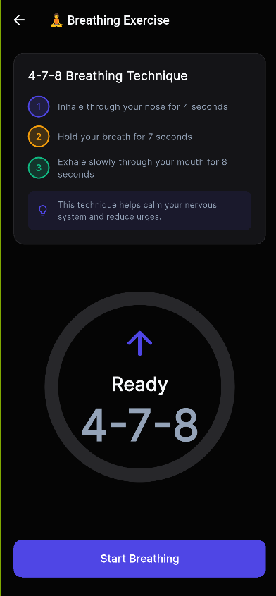
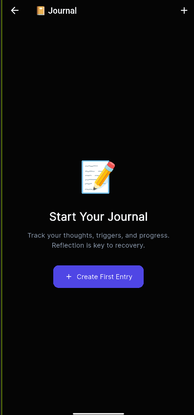

# Reclaim
A Client-Side Application for Digital Discipline, Habit Tracking, and Network-Level Content Filtering

Reclaim is a self-control utility built using the Flutter framework and native Android Kotlin engines. The project combines a modern dark-themed UI with native Android security APIs to assist users in establishing digital boundaries, tracking behavioral habits, overcoming addictive impulses, and enforcing strict content constraints.

---

## Technical Overview

The application architecture utilizes Flutter's declarative layout system and SharedPreferences-based persistence on the frontend. The security model relies on native Android components to prevent bypass attempts:

1. **Sub-Millisecond Native Accessibility Watchdog (`ReclaimAccessibilityService`):**
   - **Zero-Latency Event Pipeline:** Configured with `notificationTimeout="0"` and `typeAllMask` for instant event delivery.
   - **Real-Time URL & Search Filtering:** Monitors browser view structures across Chrome, Brave, Firefox, Edge, Samsung Internet, DuckDuckGo, Snaptube, and webviews. Evaluates queries against 5,900+ adult domains and 50+ adult keywords, instantly redirecting blocked tabs to addiction recovery literature.
   - **Surgical Anti-Cheat Protection:** Monitors System Settings and PackageInstaller screens. When a user attempts to access Reclaim's specific Accessibility toggle, App Info (Uninstall/Force Stop), or Device Admin deactivation screens:
     - Renders an opaque `TYPE_ACCESSIBILITY_OVERLAY` touch-blocking security screen above System UI and Recents.
     - Automatically dismisses system confirmation dialogs (*"Stop Reclaim Protection Service?"*) with `GLOBAL_ACTION_BACK`.
     - Issues `ActivityManager.killBackgroundProcesses()` to terminate Settings and clear its sub-page backstack from Recents.
     - **0% Impact on Other Apps:** Surgically targets Reclaim only. Users retain full access to general Settings and can freely grant/manage accessibility permissions for all other applications (TalkBack, Bitwarden, Tasker, etc.).

2. **Device Administration (`ReclaimDeviceAdminReceiver`):**
   - Enforces uninstall prevention by locking application package block state via `DevicePolicyManager`.

3. **Private DNS Mode Configuration (`DNSFilterService`):**
   - Alters system-wide DNS configurations to use CleanBrowsing Family Filter endpoints (`family-filter-dns.cleanbrowsing.org`) and DHCP fallback addresses (`185.228.168.168`, `185.228.169.168`) to restrict adult content requests at the network level.

---

## Features and Subsystems

### Content Filtering & Search Interception
- **Boundary-Based Search Analysis:** Evaluates queries using exact word boundary matching, blocking adult searches without false positives on general terms.
- **Automatic Recovery Redirection:** Instantly redirects blocked browser sessions to [EasyPeasy Method](https://easypeasymethod.org/) recovery resources.

### Protection Hub & Custom Blocking
- **Category Toggles:** Quick toggles for Adult Content, Gambling, Dating, Social Media, Streaming, and Gaming.
- **Custom App & Website Blocker:** Manage custom package and website blocklists with permanent or timed blocks (15m, 1h, 24h) and auto-expiration cleanup.
- **Daily Protection Metrics:** Tracks blocked attempts, websites blocked, apps restricted, and focus time saved.

### Emergency Panic & Recovery Tools
- **5-4-3-2-1 Grounding Checklist:** Tactile sensory exercise (Sight, Touch, Sound, Smell, Taste) to break acute urges.
- **Immediate Actions & Breathing:** Physical action chips (cold water, push-ups) and guided box breathing animation.
- **Urge Victory Logger:** "I Survived This Urge" logger recording resisted urges and focus time gained.

### Accountability & Digital Wellbeing
- **Consecutive Streak Tracker:** Live streak timer counting clean days, hours, and minutes.
- **TableCalendar Activity Logging:** Visualizes history, distinguishing clean days from reported relapse days.
- **Actual Screen Time Tracker:** Integrates Android `UsageStatsManager` to show actual daily phone usage and top used apps.
- **Reflection Journal:** Daily journal entries with 1–5 emoji mood ratings, thoughts, gratitude notes, and trigger tags.

### Security Controls
- **4-Digit Access PIN:** Enforces verification before granting access to dashboard features.

---

## App Screenshots

<p align="left">
  
  
  
  
</p>

<p align="left">
  
  
  
  
</p>

<p align="left">
  
  
</p>

---

## Installation and Deployment

### Development Prerequisites
- Flutter SDK (v3.0.0 or higher)
- Android SDK (v34 or higher, with developer configuration active on the test device)

### Setup Steps

1. **Clone the repository:**
   ```bash
   git clone https://github.com/your-username/reclaim.git
   cd reclaim
   ```

2. **Retrieve package dependencies:**
   ```bash
   flutter pub get
   ```

3. **Deploy the debug artifact to the connected device:**
   ```bash
   flutter run
   ```

4. **Grant permissions:**
   Complete the onboarding configuration wizard inside the app to activate Device Administration, System Accessibility, Usage Stats, and Private DNS options.