<h1 align="center">Reclaim - Blocker & Urge Control</h1>

<p align="center">
  <strong>Client-Side Digital Self-Discipline, Focus Enforcement & Habit Recovery Engine</strong>
</p>

<p align="center">
  
  
  
  
  
  
</p>

---

## Overview

**Reclaim** is a client-side digital discipline and recovery utility built with the Flutter framework and a Native Android Kotlin core. Engineered for individuals striving to conquer compulsive smartphone habits and addictive impulses, Reclaim pairs an OLED dark interface with sub-millisecond system-level enforcement to keep you committed during moments of high cognitive friction and craving urges.

Everything runs 100% on-device with zero analytics, zero external telemetry, and zero remote servers.

---

## Key Highlights in v2.1.0

- **Discrete Home Screen Widget:** Track your clean streak directly from your phone's home screen with a minimalist, privacy-conscious progress widget that discreetly displays progress without revealing sensitive context.
- **Urge Surfing & Emergency Wave Simulator:** Prominently positioned urge timer with an animated dual-layer craving wave canvas and 5-4-3-2-1 sensory grounding exercises.
- **Dedicated 4-Digit Security PIN & Keypad:** Full circular numeric keypad, auto-advancing 4-dot luminous indicators, and error micro-shake animations.
- **Multi-Protocol Guided Breathwork:** 4-7-8 relaxing breath, 4-4-4-4 Box breathing, and 5-5 Coherent respiration with animated radial glow orbs.
- **Sub-Millisecond Accessibility Watchdog:** Zero-latency event pipeline intercepting explicit search patterns across Chrome, Brave, Edge, Firefox, and in-app webviews.
- **Surgical Anti-Tamper Hardening:** Prevents disabling Accessibility or uninstalling Reclaim during cravings while leaving general Android Settings and other applications completely untouched.

---

## Screenshots Showcase

| 01_home_dashboard.png | 01_home_dashboard_2.png | 02_pin_lock_screen.jpeg |
| :---: | :---: | :---: |
| 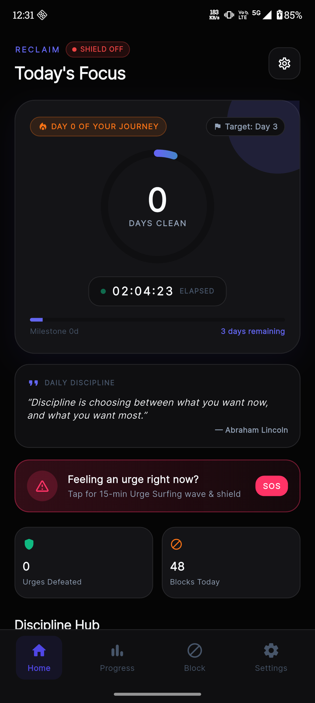 | 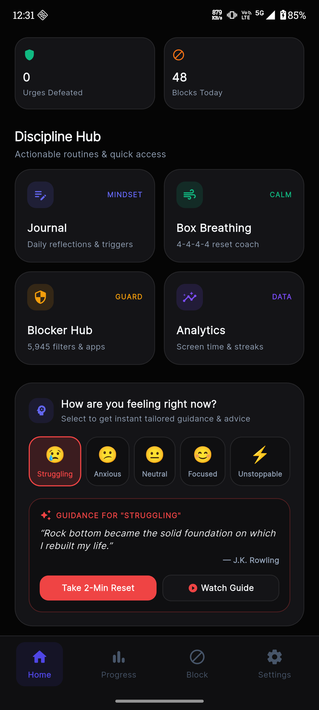 | 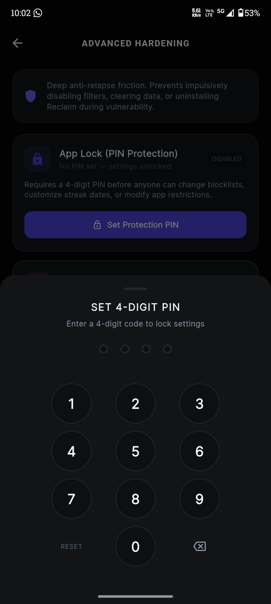 |

| 03_journal.png | 03_journal_2.jpeg | 04_journey_progress.png |
| :---: | :---: | :---: |
| 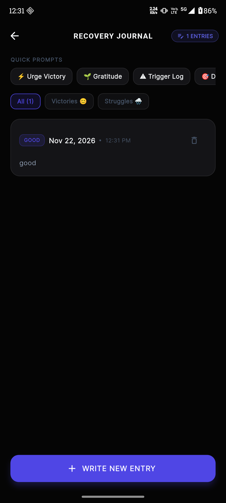 | 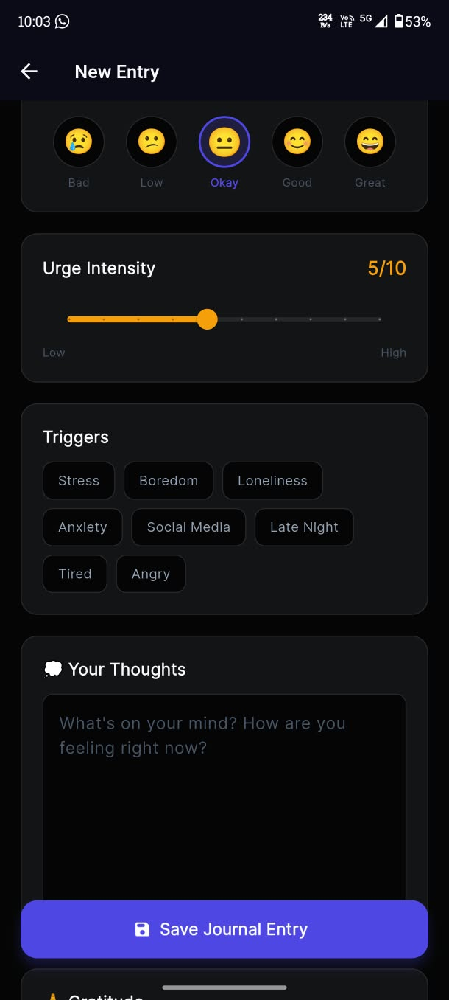 | 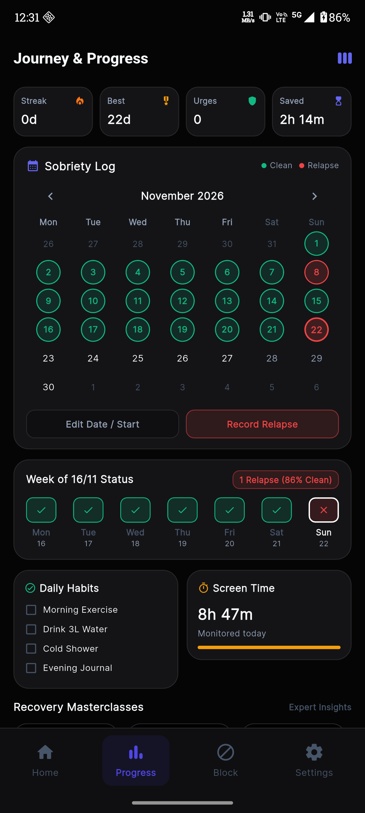 |

| 05_Blocking_protection.png | 06_breathing_protocols.png | 07_Custom_app_&_web_blocker.png |
| :---: | :---: | :---: |
| 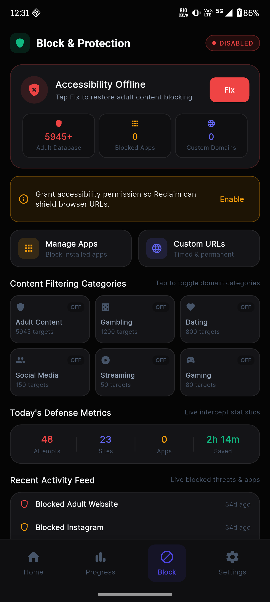 | 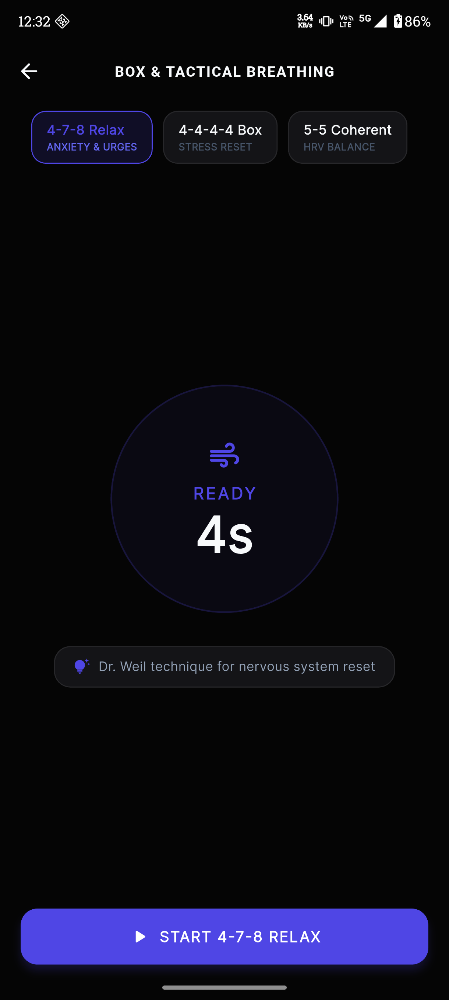 |  |

| 08_settings_overview.png | 09_settings_about.png | 10_emergency_mode.png |
| :---: | :---: | :---: |
| 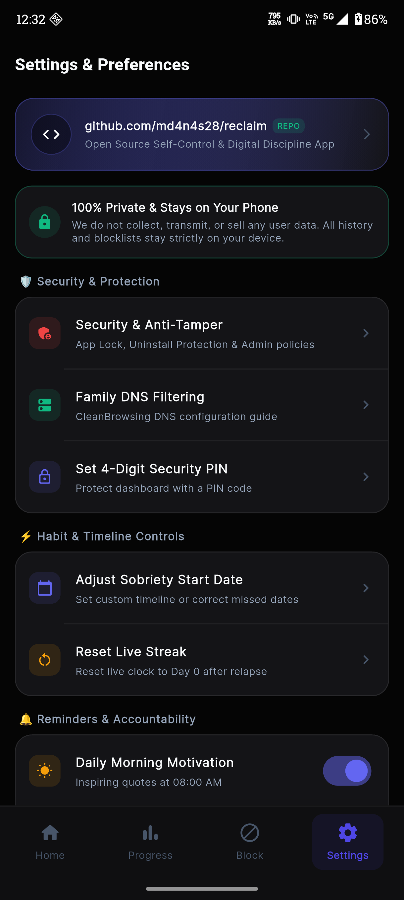 | 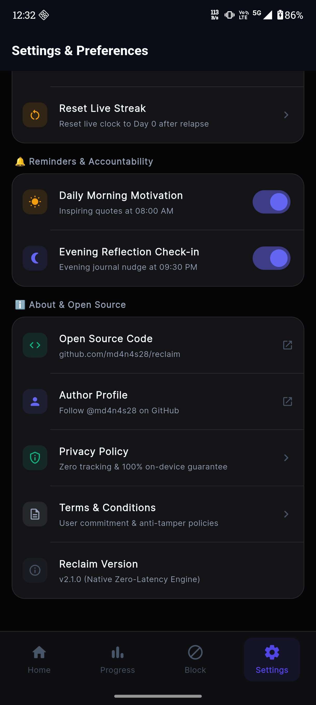 | 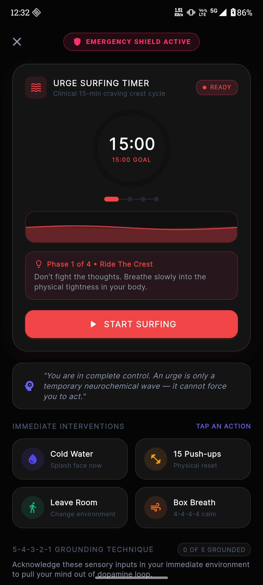 |

---

## Installation & Build Instructions

### Prerequisites
- Flutter SDK (`>= 3.0.0`)
- Android SDK (API 34 / Android 14)
- Physical Android device (recommended for testing system accessibility overlays and widgets)

### Development Setup
1. **Clone the repository:**
   ```bash
   git clone https://github.com/md4n4s28/reclaim.git
   cd reclaim
   ```

2. **Fetch dependencies:**
   ```bash
   flutter pub get
   ```

3. **Deploy to a connected device:**
   ```bash
   flutter run
   ```

4. **Grant permissions on initial launch:**
   Follow the onboarding guide to enable Accessibility Service, Usage Stats Access, and optionally Device Administration.

---

## Contribution - Open to All

Contributions are warmly welcomed and open to everyone. Whether you are a beginner exploring open-source, an Android/Kotlin specialist, a Flutter developer, or someone with UX and design ideas, your contribution matters.

### Ways you can contribute:
- **Suggest Ideas & Features:** Propose new focus tools, recovery exercises, or habit psychology features in Issues or Discussions.
- **Report or Fix Bugs:** Identify crashes, UI glitches, or bypass routes across different Android manufacturers (Samsung One UI, Xiaomi HyperOS, Pixel, etc.).
- **Enhance UI/UX:** Refine animations, improve accessibility contrast, or design new widgets.
- **Curate Blocklists:** Submit pull requests to expand `assets/listofsitetoblock.md` with zero false positives.
- **Translations & Documentation:** Translate the app or improve setup documentation.

Check out our [Contributing Guidelines (CONTRIBUTING.md)](CONTRIBUTING.md) for full instructions on setting up your local environment and submitting Pull Requests.

---

## Privacy & Security Policy

- **Zero Network Telemetry:** No user data leaves your phone.
- **Offline Journaling:** All reflections and streak timestamps are stored exclusively in local encrypted preferences.
- **Auditable Source:** All source code is open for review.

---

## License & Author

Created and maintained by [**@md4n4s28**](https://github.com/md4n4s28).  
Distributed under the MIT License. See `LICENSE` for more information.
